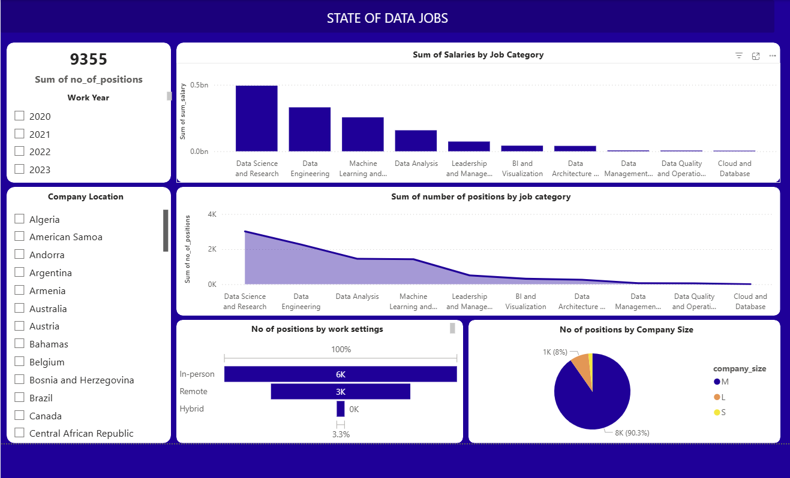

# State of Data Jobs and Salaries (2020–2023)
## Project Overview
This project explores global data job market trends and salary patterns between 2020 and 2023, using SQL for data cleaning and analysis and Power BI for interactive data visualization.
The analysis examines how salaries and job opportunities vary across job categories, experience levels, work arrangements, company locations, and company sizes.
The objective is to uncover meaningful insights into the data job market and support data-driven understanding of employment and compensation trends.

## Business Questions
1. Which data job categories have the highest aggregate salary totals?
2. How are data job opportunities distributed across experience levels?
3. Which work arrangements are most common (remote, hybrid, or in-person)?
4. Which company sizes account for the largest share of job records?
5. How do job opportunities vary across company locations?
6. How have data job trends changed between 2020 and 2023?
   
## Tools Used
1. MySQL Workbench: Data cleaning, transformation, aggregation, and SQL querying.
2. Power BI Desktop: Data modeling, DAX, data visualization, and dashboard development.
3. Microsoft Excel/CSV: Source dataset management.
   
##  Project Workflow
**1. Data Import**
Imported the raw CSV dataset containing 9,355 data job records into MySQL.
Inspected the dataset structure and column names.

**2. Data Cleaning & Preparation (SQL)**

Identified and corrected a hidden Byte Order Mark (BOM) character in the work_year column name.
Prepared the dataset for analysis.
Selected relevant dimensions and measures for aggregation.

**3. Data Analysis (SQL)**
Used GROUP BY to aggregate job records across multiple dimensions.
Applied COUNT() to calculate the number of job records.
Used SUM() to calculate aggregate salaries in USD.
Created a summary table for Power BI reporting.

**4. Data Visualization (Power BI)**
Imported the SQL summary table into Power BI.
Developed an interactive dashboard to explore job market trends.
Presented findings through visualizations and key performance indicators (KPIs).

## Key Findings
- Job Categories: Data Science and Research recorded the highest aggregate salary total.
- Work Arrangements: In-person roles accounted for approximately 61.3% of job records, followed by remote roles at 36.7%.
- Company Size: Medium-sized companies represented approximately 90.3% of the records.
- Market Coverage: The dataset covers four years, from 2020 to 2023.

## Power BI Dashboard

## Project Resources
The following resources provide access to the dataset, SQL analysis, and Power BI dashboard used in this project.

- **Dataset:** [View Original Dataset on Kaggle](https://www.kaggle.com/datasets/hummaamqaasim/jobs-in-data)
- **SQL Script:** [View SQL Analysis](data_jobs_analysis.sql)
- **Power BI Dashboard:** [Download Power BI Dashboard](State_of_Data_Jobs_Dashboard.pbix)
- **Dashboard Preview:** [View Dashboard Screenshot](State_of_Data_Jobs.png)
- **Raw Dataset:** [Download CSV Dataset](jobs_in_data.csv)
  
## Skills Demonstrated
- SQL Data Cleaning and Transformation
- SQL Aggregation and Grouping
- Data Analysis and Interpretation
- Power BI Dashboard Development
- Data Modeling and Visualization
- Business Intelligence Reporting
- Translating Data into Actionable Insights

## Conclusion
This project provided an opportunity to explore the global data job market through an end-to-end data analytics process, transforming 9,355 raw job records into meaningful insights using SQL and Power BI.

By applying SQL techniques for data cleaning, transformation, and aggregation, I prepared the dataset for analysis and developed an interactive Power BI dashboard to uncover patterns in salaries, job categories, experience levels, work arrangements, and company characteristics.

Beyond the technical implementation, this project strengthened my ability to approach data with business questions in mind, translate complex datasets into understandable insights, and communicate findings through effective visualizations.
